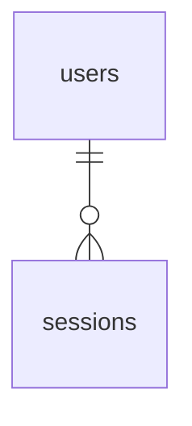

# Database

The shape of the schema, in one place. Domain language is in
[CONTEXT.md](../CONTEXT.md), the models standing on these tables are in
[app/models/CLAUDE.md](../app/models/CLAUDE.md), and the decisions behind both
are in [docs/adr/](../docs/adr/). This file is the picture: what tables exist,
how they join, and which rules the database itself enforces.

**Schema version: `<!-- TODO: version -->`** — the `define(version:)` line at
the top of [schema.rb](schema.rb). If it doesn't match, this document is stale;
see [CLAUDE.md](CLAUDE.md) for the rule that keeps it honest.

The schema is drawn in clusters rather than one sheet, because one sheet with
every table on it is unreadable. Hub tables may appear in more than one
diagram; there is still only one of each.

| Cluster | Tables |
| --- | --- |
| [Identity](#identity) | `users`, `sessions` |
<!-- TODO: One row per cluster, linking to its section below. -->

## Identity

Generated by the Rails authentication generator, extended for 2FA and rolify.

| Table | Columns | Rules in the database |
| --- | --- | --- |
| `users` | `email_address`, `password_digest`, `otp_secret` | unique `email_address` |
| `sessions` | `user_id`, `ip_address`, `user_agent` | — |

<!-- TODO: One section per cluster, in the format above. -->

## Framework tables

Not diagrammed, not ours to shape:

- `roles` + `users_roles` — rolify.
  <!-- TODO: Say whether roles are global or resource-scoped. -->
- `action_text_rich_texts` — Action Text bodies, polymorphic on `record`.
- `active_storage_blobs` / `_attachments` / `_variant_records` — uploads. Must
  stay in **proxy mode** so blobs are served from our own origin (see the CSP
  rules in the root CLAUDE.md).
- Solid Queue, Cache and Cable each own a separate PostgreSQL database with its
  own schema file: [queue_schema.rb](queue_schema.rb),
  [cache_schema.rb](cache_schema.rb), [cable_schema.rb](cable_schema.rb).

## Deletion

No foreign key carries an `ON DELETE` clause unless listed here. Deletion is
guarded in the models instead — the rules, and the few deliberate exceptions,
are in [app/models/CLAUDE.md](../app/models/CLAUDE.md).

<!-- TODO: List every foreign key with ON DELETE CASCADE / NULLIFY, and why. -->

## Not here yet

<!-- TODO: Tables that are designed but not yet built, and things absent by
design. -->

## Seeds

Ordinary seeds are [seeds.rb](seeds.rb).
<!-- TODO: Any development-only demo data tasks and where they are documented. -->
